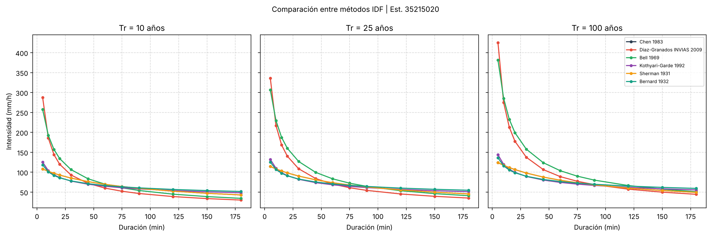

# 🌧️ Análisis de frecuencia de lluvias máximas y curvas IDF

Herramienta en Python para el análisis pluviométrico de estaciones del IDEAM (Colombia): limpia la serie de precipitación diaria, construye los máximos anuales, ajusta distribuciones de probabilidad y genera curvas de Intensidad–Duración–Frecuencia (IDF) con seis métodos distintos. Exporta los resultados a Excel, PDF y Word.

**Caso de ejemplo incluido:** estación Aeropuerto Yopal (35215020), Casanare, 1974–2026.



## 📋 Resultado del caso de ejemplo

| Indicador | Valor |
|---|---|
| Estación | Aeropuerto Yopal – 35215020 |
| Periodo de registro | 1974-12-01 → 2026-05-20 |
| Años útiles de la serie de máximos anuales | 46 |
| Pmax 24 h medio multianual | 115.28 mm |
| Distribución seleccionada | Log-Pearson III (AIC = −69.52; pruebas KS y Anderson-Darling: OK) |
| Pmax 24 h para Tr = 25 años | 177.08 mm |
| Región usada para Díaz-Granados / INVIAS | Orinoquía |

## ⚙️ Qué hace

1. **Lee** estaciones IDEAM en CSV (separador `;`) y filtra por variable, parámetro, nivel de aprobación y unidad.
2. **Detecta** si los valores vienen en mm o en décimas de mm.
3. **Completa faltantes** con estaciones auxiliares (regresión múltiple, regresión simple, razón normal o IDW).
4. **Construye** la serie de máximos anuales y detecta valores atípicos con Grubbs-Beck.
5. **Aplica pruebas hidrológicas:** Wald-Wolfowitz, autocorrelación, Mann-Kendall con pendiente de Sen, Wilcoxon y Pettitt.
6. **Ajusta 9 distribuciones:** Normal, Log-Normal, Gumbel, GEV, Weibull, Gamma, Pearson III, Log-Pearson III y Exponencial. Evalúa la bondad de ajuste (AIC, BIC, KS, Anderson-Darling) y calcula intervalos de confianza por bootstrap.
7. **Construye 6 curvas IDF:** Chen (1983), Díaz-Granados / INVIAS (2009), Sherman (1931), Bernard (1932), Bell (1969) y Kothyari-Garde (1992).
8. **Exporta** un Excel de 30 hojas, un PDF con todas las gráficas y una memoria de cálculo en Word.

## 🗂️ Estructura del repositorio

```
.
├── main.py                  # Punto de entrada (línea de comandos)
├── idf_tool/                # Módulos del análisis
│   ├── io_utils.py          #   lectura de CSV IDEAM
│   ├── cleaning.py          #   limpieza y unidades
│   ├── gap_filling.py       #   completado de faltantes
│   ├── series.py            #   serie de máximos anuales y outliers
│   ├── tests.py             #   pruebas hidrológicas
│   ├── distributions.py     #   ajuste de distribuciones y bondad
│   ├── idf_methods.py       #   los 6 métodos IDF
│   ├── plotting.py          #   gráficas
│   ├── reports.py           #   exportación a Word
│   └── config.py            #   configuración
├── config_ejemplo.yaml      # Configuración de ejemplo
├── ejemplo_entrada/         # CSV de la estación de ejemplo (datos públicos IDEAM)
├── ejemplo_resultados/      # Excel y gráficas generadas con el ejemplo
└── requirements.txt
```

## 🔧 Cómo ejecutarlo

```bash
pip install -r requirements.txt
python main.py --carpeta-entrada ./ejemplo_entrada --carpeta-salida ./salida \
    --principal "Yopal Pluviometria - 35215020.csv" --region Orinoquia
```

El ejemplo tarda unos 3 minutos. También se puede usar un archivo de configuración: copia `config_ejemplo.yaml` a `config.yaml`, edítalo y ejecuta `python main.py --config config.yaml`. Argumentos principales: `--tr-diseno` (periodo de retorno), `--factor` (unidades), `--no-tests`, `--no-ic` (más rápido) y `--no-word`.

Formato esperado del CSV (descarga de IDEAM, separador `;`):

```
CodigoEstacion;NombreEstacion;Variable;Parametro;Fecha;Unidad;Valor;NivelAprobacion
```

## ⚠️ Limitaciones

- Analiza **una estación a la vez**; no hace regionalización.
- Sherman, Bernard y Kothyari-Garde se calibran sobre la curva de Chen, no sobre registros de pluviógrafo, y Bell asume una relación P1h/P24h de 0.45. Verificar localmente si hay datos sub-diarios.
- Las pruebas asumen datos independientes e idénticamente distribuidos. Si Mann-Kendall o Pettitt rechazan, el análisis estacionario es cuestionable.
- La selección automática de la distribución debe revisarse con el gráfico Q-Q, sobre todo en series de menos de 25 años.
- Los resultados son una referencia de análisis y no reemplazan la validación contra la información regional oficial del IDEAM para un diseño definitivo.

## 🛠️ Stack

Python · pandas · NumPy · SciPy · matplotlib · openpyxl · python-docx · PyYAML

## 📄 Derechos de autor

© 2026 Luis Guillermo Barrera Barrios. Todos los derechos reservados. El código se publica para consulta y demostración; no se autoriza su copia, modificación, distribución ni uso comercial sin autorización escrita del autor. Los datos de ejemplo provienen del IDEAM ([DHIME](http://dhime.ideam.gov.co/)).

## 👤 Autor

**Luis Guillermo Barrera Barrios** · Ingeniero Civil | Data Analyst  
📧 Lgbarrerab@gmail.com · 🔗 [LinkedIn](https://www.linkedin.com/in/luis-guillermo-barrera-barrios-64aa5790) · [Portafolio](https://lgbarrerab-cpu.github.io)
